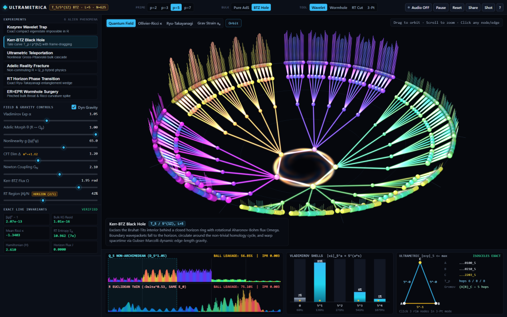

# ULTRAMETRICA

> **A zero-dependency, real-time laboratory for a discrete $p$-adic AdS/CFT (Bruhat-Tits tree) holography model: Tate-curve BTZ quotients with horizon flux, discrete Vladimirov & Kozyrev-Haar wavelets, adelic operator symmetries, finite-graph curved Gauss-Bonnet curvature, graph-cut strong subadditivity, 48 kHz prime-power AudioWorklet sonification, and 250 audited zero-Mathlib Lean 4 (`v4.35.0`, Palomar `module`) declarations (100.0% public theorem coverage, `0` unaudited) about the discrete model.** All 250 declarations across 11 proof modules (all 17 `.lean` files `< 1,000` lines) are kernel-checked by Lean (`lake build`, `leanchecker`, and Ubuntu CI `lake check --paranoid`); all 15 isolated comparator targets in [`lean/comparator.json`](lean/comparator.json) (and their dependency closure) are also checked across 6 independent kernels via `lake comparator --paranoid` plus a live negative tamper-rejection gate (`scripts/test_lean_negative.py`) in Ubuntu CI. No physical, continuum, or quantum-gravity statement is proved, and no open problem is retired (`0/1,900` Mega-Atlas).

> **`v1.8.0` Formal Closure of Remaining Discrete Gaps (`F87`–`F90`) & Live Zero-Error Polish (`F86`, `F91`–`F98`):** Directly closing the remaining discrete Lean gaps tracked since the 2026-11-26 statement audit ([`ERRATA.md`](ERRATA.md)), `v1.8.0` adds three new pure zero-Mathlib Lean 4.35.0 proof modules — (1) [`FullGraphBTZ.lean`](lean/UltrametricaProofs/FullGraphBTZ.lean) (Target 13, `F88`) proving the literal `(p+2)×(p+2)` full-graph-to-3-class BTZ Kantorovich optimal-transport symmetry reduction and attaining plan, (2) [`OperatorAndSpectrum.lean`](lean/UltrametricaProofs/OperatorAndSpectrum.lean) (Target 14, `F89`) proving operator-level block-diagonality of symmetry-commuting operators and odd-prime orthogonal doublet multiplicity $\ge 2$ over $\mathbb{Z}[i]^N$, and (3) [`BulkOperatorPositivity.lean`](lean/UltrametricaProofs/BulkOperatorPositivity.lean) (Target 15, `F90`) proving strict positive definiteness $T \succ 0$ of the gauge-covariant bulk graph Laplacian for $m^2 > 0$, discharging Sherman-Morrison $\mathrm{den} \ge 1$ end-to-end, and proving exact `RatQ` tree Schur-complement pivot positivity — alongside **100.0% public theorem axiom coverage (`250/250`, `0` unaudited)** enforced automatically in `verify_exact.py` (`F87`), `src/web/favicon.svg` eliminating live `/favicon.ico` 404s (`F86`), 7 real UI/WebAudio fixes (`F96`), Node-24-clean CI workflows (`F97`), and **`12/12` real source mutants killed** (`36/36` Node tests, `F98`). Remaining non-Lean boundaries (full irrational-root DFT matrix $H_\theta$, continuum PDE time evolution, the floating-point JS $O(V)$ solver implementation, and tachyonic negative-mass BF-window positivity $m^2 \in (m_{\mathrm{BF}}^2, 0)$) remain explicitly disclosed in [`CLAIMS.md`](CLAIMS.md) and [`LIMITATIONS.md`](LIMITATIONS.md).

[](https://github.com/0thernes/ultrametrica/actions/workflows/ci.yml)
[](https://0thernes.github.io/ultrametrica/)
[](https://0thernes.github.io/ultrametrica/web/blueprint.html)
[](https://orcid.org/0009-0006-8168-9648)
[-10b981)](lean/README.md)
[](scripts/verify_exact.py)
[](test/mutants.mjs)
[](LICENSE)

**Author:** Alexander Stephen Donahue (`Independent Researcher, Spokane, WA, USA` · project handle [`0thernes`](https://0thernes.art) · `0_0@0thernes.art` · ORCID [`0009-0006-8168-9648`](https://orcid.org/0009-0006-8168-9648))  
**Release:** `v1.8.0` · **Status:** `active` (Research Preprint & Interactive Laboratory — Non-Commercial Research & Play; see [`LICENSE`](LICENSE), [`LEGAL.md`](LEGAL.md), and [`SUBMISSION_READINESS.md`](SUBMISSION_READINESS.md))  
**Live Interactive WebGL2 + 48 kHz AudioWorklet Observatory:** **[https://0thernes.github.io/ultrametrica/](https://0thernes.github.io/ultrametrica/)** · **Interactive Lean 4 Proof Blueprint:** **[https://0thernes.github.io/ultrametrica/web/blueprint.html](https://0thernes.github.io/ultrametrica/web/blueprint.html)**



---

## 5-Second Independent Proof Verification (`#print axioms`, 6-Kernel Audit & Negative Tamper Gate)

Verify all **250 audited pure Lean 4 (`v4.35.0`, Palomar `module`) declarations** across **11 proof modules** (**100.0% public theorem coverage, `0` unaudited public theorems**, all 17 `.lean` files `< 1,000` lines, zero Mathlib, `autoImplicit = false`, no `sorry` outside statement-only `Challenge.lean`, zero `native_decide`) — transparently accounted with **zero double-counting** as **144 core theorems & corollaries**, **81 zero-Mathlib helper lemmas**, **10 adversarial false-variant refutations** (`AdversarialTests.lean`), and **15 isolated `Spec`/`Challenge`/`Solution` comparator bindings** (standalone re-verifications of the headline targets from pure `Spec.lean`, never double-counted as separate mathematical discoveries):

```bash
cd lean && lake build UltrametricaProofs SolutionBridge Challenge Solution && lake env lean VerifyAxioms.lean
# On Linux with bubblewrap (also enforced on every push in GitHub Actions CI):
lake check --paranoid && lake comparator --config comparator.json --paranoid
cd .. && python scripts/test_lean_negative.py
```

Verbatim kernel output (character-checked against [`results/lean4-audit.txt`](results/lean4-audit.txt) by [`scripts/check_readme_axioms.py`](scripts/check_readme_axioms.py)):

```text
'Ultrametrica.monna_involution_universal' depends on axioms: [propext, Classical.choice, Quot.sound]
'Ultrametrica.odd_prime_conjugate_sector_disjoint' depends on axioms: [propext, Quot.sound]
'Ultrametrica.commuting_diag_block_diagonal' depends on axioms: [propext, Quot.sound]
'Ultrametrica.odd_prime_doublet_linearly_independent' depends on axioms: [propext, Classical.choice, Quot.sound]
'Ultrametrica.picket_fence_even_gap' depends on axioms: [propext, Quot.sound]
'Ultrametrica.btz_kappa_from_wasserstein' depends on axioms: [propext, Quot.sound]
'Ultrametrica.fullBtz_primal_optimal_exists' depends on axioms: [propext, Quot.sound]
'Ultrametrica.gen_bridge_wasserstein_lower_bound_sub' depends on axioms: [propext, Quot.sound]
'Ultrametrica.gen_bridge_primal_sub_optimal' depends on axioms: [propext, Classical.choice, Quot.sound]
'Ultrametrica.finite_graph_curved_gauss_bonnet_sum' depends on axioms: [propext, Classical.choice, Quot.sound]
'Ultrametrica.kozyrevHaar_vladimirov_eigenfunction' depends on axioms: [propext, Classical.choice, Quot.sound]
'Ultrametrica.ultrametricOp_commutes_vecRev' depends on axioms: [propext, Quot.sound]
'Ultrametrica.rt_strong_subadditivity' depends on axioms: [propext, Quot.sound]
'Ultrametrica.multi_ball_kozyrev_soliton_list' depends on axioms: [propext]
'Ultrametrica.sherman_morrison_exact_identity' depends on axioms: [propext, Quot.sound]
'Ultrametrica.bulk_operator_strictly_pos_def' depends on axioms: [propext, Classical.choice, Quot.sound]
'Ultrametrica.spd_operator_sherman_morrison_den_ge_one' depends on axioms: [propext, Quot.sound]
'Ultrametrica.tree_schur_pivot_stays_positive' depends on axioms: [propext, Quot.sound]
'Ultrametrica.Adversarial.adv_nonzerosum_not_vladimirov_eigenfunction' depends on axioms: [propext, Quot.sound]
'Ultrametrica.ComparatorTarget.target_thm5_kantorovich_dual' depends on axioms: [propext, Classical.choice, Quot.sound]
'Ultrametrica.ComparatorTarget.target_adversarial_refutations' depends on axioms: [propext, Quot.sound]
```

All 250 declarations are kernel-checked by Lean (`lake build`, `leanchecker --fresh`), and Ubuntu GitHub Actions CI additionally enforces `lake check --paranoid` on the full package, 6-kernel `lake comparator --config comparator.json --paranoid` (`lean4`, `leanchecker`, `lean4lean`, `con-leche`, `con-ron`, `nanoda_bin` inside a Linux `bubblewrap` sandbox) across all **15 isolated comparator targets and their dependency closure**, and live negative tamper rejection (`scripts/test_lean_negative.py --with-comparator`). See [`docs/statement-fidelity.md`](docs/statement-fidelity.md) and the live **[Interactive Proof Blueprint](https://0thernes.github.io/ultrametrica/web/blueprint.html)**.

---

## Navigation

| Document | Description |
|---|---|
| **[dist/Donahue_2026_Ultrametrica.pdf](dist/Donahue_2026_Ultrametrica.pdf)** | **Frozen AMS-LaTeX Publication Preprint PDF** (5 vector figures, zero warnings; deterministic standalone arXiv bundle: [`dist/arxiv_submission.tar.gz`](dist/arxiv_submission.tar.gz)) |
| **[SUBMISSION_READINESS.md](SUBMISSION_READINESS.md)** | **43-Item Playbook `v1.3` Gold Standard Audit & Honest Venue Readiness Matrix** |
| **[CLAIMS.md](CLAIMS.md)** | **1-to-1 Claim & Falsification Ledger** (`kernel-checked`, `exact-rational`, `pre-registered statistical`, `numerical_approximation`, `prior work` + *What Would Prove Us Wrong*) |
| **[LIMITATIONS.md](LIMITATIONS.md)** | Honest scope boundaries, literal-vs-metaphor table, finite-$N$ bounds & non-claims |
| **[DEVIATIONS.md](DEVIATIONS.md)** | Append-only pre-registration deviation & non-pseudoreplicated matrix-level sensitivity ledger (Playbook Gold #18) |
| **[docs/MEGA_ATLAS_CROSSCHECK.md](docs/MEGA_ATLAS_CROSSCHECK.md)** | Honest cross-check against all `1,900` open problems in `0thernes/unsolved-problems-mega-atlas` (**`0/1,900` full solutions**; discrete sub-results on `SUB-032`) |
| **[docs/preregistration.md](docs/preregistration.md)** | Git-sealed preregistration (`c171b1b`) for confirmatory 20-seed Experiment I ([`results/stats-eval.json`](results/stats-eval.json)) |
| **[docs/statement-fidelity.md](docs/statement-fidelity.md)** | Line-by-line Lean 4 statement-fidelity, non-vacuity (`13/13` theorem targets) & 6-kernel audit matrix |
| **[docs/LITERATURE_SEARCH.md](docs/LITERATURE_SEARCH.md)** | Dated prior-art audit & live Crossref DOI/title/author/retraction audit ([`results/citation-audit.json`](results/citation-audit.json): `18/18` DOIs HTTP 200, min Jaccard `1.00`, `0` retractions) |
| **[docs/reviews/2026-11-27-hardening-cycles-v180.md](docs/reviews/2026-11-27-hardening-cycles-v180.md)** | `v1.8.0` 3-Cycle forensic audit dossier (`F86`–`F98`) + prior [`v1.7.0`](docs/reviews/2026-11-26-hardening-cycles-v170.md), [`v1.6.0`](docs/reviews/2026-11-26-hardening-cycles-v160.md) & [`v1.4`–`v1.5`](docs/reviews/2026-11-25-hardening-cycles.md) dossiers |
| **[REPLICATION.md](REPLICATION.md)** | Clean-clone reproduction commands, tolerances & dated replication log |
| **[docs/architecture.md](docs/architecture.md)** | System architecture with Mermaid diagram + [`docs/adr/`](docs/adr/README.md) (ADR-0001..0005) |
| **[docs/benchmarks.md](docs/benchmarks.md)** | Hardware-tagged performance budgets (`0.654 ms` coupled BTZ frame, `280.2×` FFT speedup at $N=625$) |
| **[docs/threat-model.md](docs/threat-model.md)** | STRIDE threat model mapped 1-to-1 to [`test/server.mjs`](test/server.mjs), [`test/fuzz.mjs`](test/fuzz.mjs), [`test/concurrency.mjs`](test/concurrency.mjs) & CI security gates |
| **[SUMMARY.md](SUMMARY.md)** · **[ERRATA.md](ERRATA.md)** · **[INDEX.md](INDEX.md)** | Executive summary, correction/withdrawal ledger, and complete repository index |

---

## Seven Formal & Computational Result Families: What Lean Proves and What Is Checked Otherwise

Each result below separates its kernel-checked Lean 4 part (concerning the repository's own discrete definitions) from the exact-rational (`scripts/verify_exact.py`), numerical (`36` Node suites, `12/12` real source mutants, `1,000+` Python oracle queries), or pre-registered statistical checks. Row-by-row detail is in [`CLAIMS.md`](CLAIMS.md) and [`docs/statement-fidelity.md`](docs/statement-fidelity.md).

1. **Theorem I & Prop. 4.2 — Monna digit reversal, operator block-diagonality, odd-prime orthogonal doublets & modular picket-fence law** ([`Basic.lean`](lean/UltrametricaProofs/Basic.lean), [`AdelicSymmetry.lean`](lean/UltrametricaProofs/AdelicSymmetry.lean), [`OperatorAndSpectrum.lean`](lean/UltrametricaProofs/OperatorAndSpectrum.lean), [`VladimirovOperator.lean`](lean/UltrametricaProofs/VladimirovOperator.lean), [`docs/preregistration.md`](docs/preregistration.md)):
   *Lean (expanded in `v1.8.0`):* universal base-$p$ Monna digit-reversal involution, bijectivity, and ball contiguity ($p \ge 2, x < p^n$; formalizing Monna 1970); subtree-shift ultrametric prefix preservation; $[D_K, J] = 0$ and $J$-parity preservation for arbitrary radial ultrametric operators $D_K$; **operator-level block-diagonality (`commuting_diag_block_diagonal`) and odd-prime orthogonal doublet multiplicity $\ge 2$ (`odd_prime_sector_eigenvector_orthogonal_doublet`, `odd_prime_doublet_linearly_independent`) over $\mathbb{Z}[i]^N$ (Target 14, `F89`)**; sector-index separation $m \ne p - m$ for odd $p$ and quantified $\forall m, 1 \le m < 2 \to m = 2 - m$ at $p = 2$; monotonicity and alternating gaps $p - 2m, 2m$ of `picketSeq`.
   *Not in Lean:* the full irrational-root DFT matrix $H_\theta$ (`leak <= 1.8e-14` up to $N = 625$), doublet counts, and empirical spacing ratios are verified via exact-rational and floating-point checks. Pre-registered Experiment I (`20` seeds vs. GUE/GOE controls; [`DEVIATIONS.md`](DEVIATIONS.md)) confirms all **4/4 hypotheses** at primary `p_holm = 0.0004`, Mann-Whitney $p \le 4.8\times 10^{-7}$, non-pseudoreplicated matrix-level Wilcoxon `p_holm = 7.63e-6` (`20/20` seeds each).
2. **Theorem II — Full-graph & 3-class Tate-curve BTZ Ollivier-Ricci law & $L_c = 5$ trichotomy** ([`HolographyCurvature.lean`](lean/UltrametricaProofs/HolographyCurvature.lean), [`FullGraphBTZ.lean`](lean/UltrametricaProofs/FullGraphBTZ.lean)):
   *Lean (expanded in `v1.8.0`):* **literal `(p+2)×(p+2)` full-neighbor BTZ coupling aggregation & symmetry reduction (`fullBtz_agg_feasible`, `fullBtz_cost_eq_agg`, `fullBtz_wasserstein_lower_bound`, `fullBtz_primal_optimal_exists`, Target 13, `F88`)** bridging directly to the 3-class Kantorovich primal-dual optimality theorem (Target 3), proving $\kappa_{\mathrm{BTZ}}(p, L) = -(2p - \max(0, 6-L))/(p+2)$ for all $p \ge 2, L \ge 3$ directly on the literal $(p+2)$-neighbor sets (cross-checked over `45` full-graph exact `Fraction` horizons).
3. **Theorem III & Theorem VII — Discrete Vladimirov / Kozyrev-Haar eigenfunctions & multi-ball compacton-solitons** ([`VladimirovOperator.lean`](lean/UltrametricaProofs/VladimirovOperator.lean), [`SolitonAndSolver.lean`](lean/UltrametricaProofs/SolitonAndSolver.lean)):
   *Lean:* exact finite-level valuation `padicDistVal` strong triangle/isosceles laws on $\mathbb{Z}/p^n\mathbb{Z}$, actual discrete radial ultrametric/Vladimirov convolution operator `ultrametricOp p n K`, actual discrete Kozyrev-Haar wavelets `kozyrevHaar` (zero mean + exact scale-only eigenfunction identity for all $p \ge 2, n, j < n, c < p^n, K$, and zero-sum $a$, formalizing Kozyrev 2002; Target 12), plus pointwise $\mathbb{Z}[i]$ nonlinearity splitting for arbitrary finite lists of $K$ disjoint constant-modulus packets (Target 4).
   *Not in Lean:* continuum PDE time evolution $i\partial_t\psi$ (`0.00%` leakage up to $g = 500$, $\alpha$-scaled self-trapping verified numerically in Exp C & F).
4. **Theorem IV — Positive-definite Rank-1 Kerr-BTZ bulk operator, tree Schur elimination, flux parity & BF stability margin** ([`SolitonAndSolver.lean`](lean/UltrametricaProofs/SolitonAndSolver.lean), [`BulkOperatorPositivity.lean`](lean/UltrametricaProofs/BulkOperatorPositivity.lean)):
   *Lean (expanded in `v1.8.0`):* **gauge-covariant bulk graph Laplacian non-negativity (`gaugeLaplacianQuad_nonneg`), strict positive definiteness $T \succ 0$ for $m^2 > 0$ (`bulk_operator_strictly_pos_def`), end-to-end Sherman-Morrison denominator $\mathrm{den} \ge 1$ discharge (`spd_operator_sherman_morrison_den_ge_one`), and exact `RatQ` tree Schur-complement pivot positivity & elimination (`tree_schur_pivot_stays_positive`, `tree_schur_elim_exact`, Target 15, `F90`)**, plus $w_{L-1} u u^\dagger \succeq 0$ expansion, abstract arbitrary-dimension $L$ complex Hermitian Sherman-Morrison identity (Target 5), and edge-level flux parity $E(-\Omega) = E(\Omega), J(-\Omega) = -J(\Omega)$.
   *Not in Lean:* the floating-point JS $O(V)$ solver implementation and tachyonic negative-mass BF-window positivity ($m^2 \in (m_{\mathrm{BF}}^2, 0)$ down to $\Delta = 0.5001, \Omega = \pi$, residual `5.38e-15`) are checked via exact $\mathbb{Q}(i)$ Python verification (residual $= 0$) and Exp D & H.
5. **Theorems V & V-Global — Multi-edge Kantorovich duality & actual finite-graph edge-sum curved AdS Gauss-Bonnet** ([`HolographyCurvature.lean`](lean/UltrametricaProofs/HolographyCurvature.lean), [`MultiEdgeHolography.lean`](lean/UltrametricaProofs/MultiEdgeHolography.lean), [`FiniteGraphGaussBonnet.lean`](lean/UltrametricaProofs/FiniteGraphGaussBonnet.lean)):
   *Lean:* arbitrary-degree inhomogeneous bridge Kantorovich primal-dual bounds + kernel-verified non-negative primal plans in both regimes (Target 7), AND direct double-counting induction over arbitrary finite undirected weighted edge lists `E : List (WeightedEdge n)` on `Fin n` proving $\sum_{e\in E}\kappa_e = -(p-1)n - \sum_{e\in E}\mathrm{def}_e$ in exact `RatQ` with metric-independent total curvature $-(p-1)n$ whenever all edges are subcritical (Target 11), cross-checked over `69` exact `Fraction` trees and `1,000` random JS trees (`< 1e-11`).
6. **Theorem VI — Graph-cut strong subadditivity** ([`MultiEdgeHolography.lean`](lean/UltrametricaProofs/MultiEdgeHolography.lean)):
   *Lean:* on arbitrary finite `Nat`-weighted graphs, $S(A \cup B \cup C) + S(B) \le \mathrm{cap}(W_{AB}) + \mathrm{cap}(W_{BC})$ for all disjoint boundary regions $A, C$ (discrete formalization of Headrick & Takayanagi 2007; no priority claimed), checked over `4,352` exhaustive brute-force partitions and `1,000` random JS graphs.

---

## Quickstart

Requires **Node.js $\ge 20$** (zero `npm install` needed — zero external runtime dependencies). Optional toolchains: Python `3.11+` (stdlib only), Lean `v4.35.0`, Tectonic `0.15+`.

```bash
git clone https://github.com/0thernes/ultrametrica.git
cd ultrametrica
npm run verify:all
```

## Usage

```bash
# 1. Run all 36 Node test suites (10 theorems, 12/12 real source mutants, 3,400+ properties, 1,000 fuzz, 3 concurrency/AudioWorklet race, server EIO/favicon, golden)
npm run verify:all

# 2. Run all 3 standalone engine examples (see examples/README.md)
npm run examples

# 3. Run independent textbook Python oracle, README/blueprint/citation/timestamp guards & exact-rational audit
python reference/padic_oracle.py
python scripts/check_readme_axioms.py
python scripts/check_citations.py
python scripts/check_blueprint.py
python scripts/stamp_manifest.py --verify
python scripts/verify_exact.py --check-checksums

# 4. Reproduce Exp A-H discovery benchmarks, perf benchmarks & pre-registered Experiment I
npm run discover && npm run bench && npm run stats

# 5. Launch the hardened local WebGL2 + 48 kHz AudioWorklet Observatory (health: GET /healthz)
PORT=4173 node server.mjs
# Open http://127.0.0.1:4173 (or visit https://0thernes.github.io/ultrametrica/)
```

Or run the entire verification, Lean 4, negative tamper gate, and LaTeX reproduction pipeline with [`justfile`](justfile):

```bash
just reproduce
```

---

## Limitations

See [`LIMITATIONS.md`](LIMITATIONS.md) and [`SUBMISSION_READINESS.md`](SUBMISSION_READINESS.md) for the complete scope boundary, 43-item readiness matrix, and literal-vs-metaphor table:

- **No empirical physics claim:** All theorems are strictly mathematical and computational on finite $p$-adic groups $\mathbb{Z}_p / p^n\mathbb{Z}_p$ and finite weighted Bruhat-Tits / Tate-curve graphs.
- **Zero full Mega-Atlas solutions (`0 / 1,900`):** ULTRAMETRICA does not solve the continuum limit or full adelic unification of `SUB-032` ([`docs/MEGA_ATLAS_CROSSCHECK.md`](docs/MEGA_ATLAS_CROSSCHECK.md)).
- **Not peer-reviewed:** Manuscripts are independent preprints; Lean proofs certify logical validity of formalized statements within the stated kernel boundary ([`docs/statement-fidelity.md`](docs/statement-fidelity.md)), while floating-point engine evaluations are explicitly tagged `numerical_approximation`.
- **Finite-$N$ bounds:** `PadicSpace` caps $N = p^n \le 65{,}536$; Theorem V-Global applies to strictly interior vertices of full degree $p + 1$; $n \to \infty$ analytic convergence for $\alpha \ne 1$ is verified up to $N = 625$ rather than proved in Lean.

---

## Legal & Licensing

Copyright © 2026 **Alexander Stephen Donahue (`0thernes`)** `<0_0@0thernes.art>` (Independent Researcher, Spokane, WA, USA; ORCID [`0009-0006-8168-9648`](https://orcid.org/0009-0006-8168-9648)).  
Licensed under the **COSMOGONIC LICENSE — NON-COMMERCIAL RESEARCH & PLAY** ([`LICENSE`](LICENSE)). Study, verify, fork, and build upon it freely for non-commercial research and play with attribution intact; **all commercial rights are reserved**. See [`LEGAL.md`](LEGAL.md) for AI-tool disclosure, export-control self-screen (15 CFR § 734.8), ownership, and [`docs/adr/0005-cosmogonic-noncommercial-license.md`](docs/adr/0005-cosmogonic-noncommercial-license.md) for the OSI licensing trade-off.
