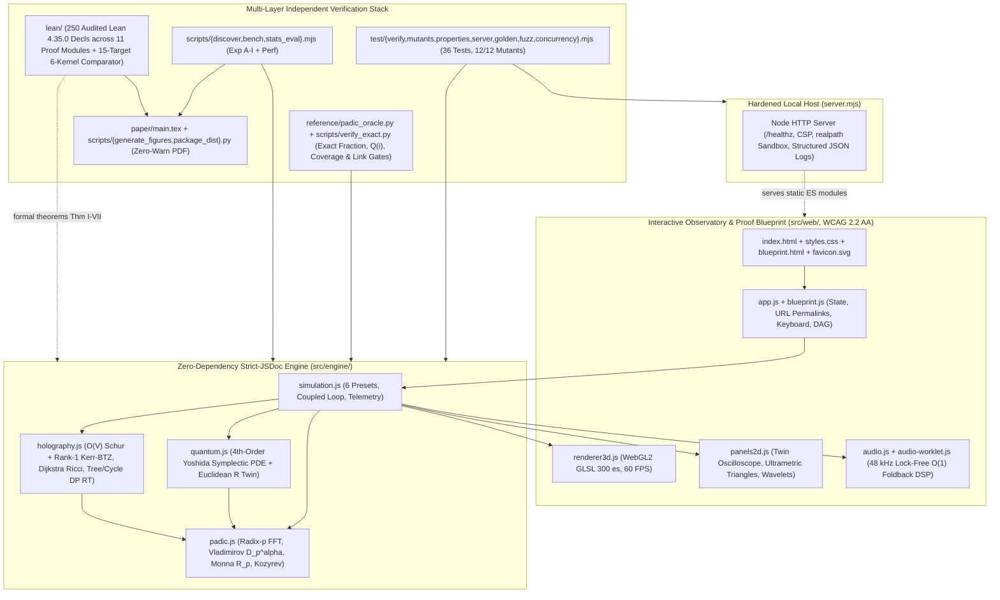

# System Architecture (`docs/architecture.md`)

> Build Standard `A20`. ULTRAMETRICA (`v1.8.0`) is engineered as a **zero-dependency**, cleanly layered mathematical-physics engine, real-time WebGL2/AudioWorklet observatory, interactive Lean 4 Proof Blueprint, and pure Lean 4 (`v4.35.0`, Palomar `module`) formal verification stack.

## 1. High-Level Layered Architecture

---

## 2. Module Responsibilities & Data Flow

### Layer 1 — Pure Mathematical Engine (`src/engine/`, Strict `tsc --noEmit` Zero-Error JSDoc)
- **`padic.js` (`PadicSpace`):** Encodes the finite $p$-adic boundary $\mathbb{Z}_p / p^n \mathbb{Z}_p$ ($N = p^n \le 65{,}536$, prime $p \ge 2$, $n \ge 2$). Provides exact little-endian digit extraction, universal base-$p$ Monna digit-reversal involution $R_p$ (`revTable`), ultrametric norm $|x - y|_p$, native $O(p N \log_p N)$ unitary Radix-$p$ Pontryagin FFT (`fftForward`/`fftInverse`), Vladimirov spectrum $|\xi_k|_p^\alpha$, RMS-calibrated Euclidean twin spectrum, and orthonormal Kozyrev wavelets $\psi_{j,b,m}$.
- **`quantum.js` (`PadicQuantumEngine`):** Evolves the nonlinear $p$-adic Gross-Pitaevskii equation $i \partial_t \psi = (D_p^\alpha + g|\psi|^2 + V_{\mathrm{grav}})\psi$ alongside a synchronized Archimedean $\mathbb{R}$ twin using 4th-order Yoshida symplectic operator splitting (3 symmetric Drift-Kick-Drift substeps), with strict constructor and diagnostics finiteness validation (`F94`).
- **`holography.js` (`BruhatTitsBulk`):** Constructs the $(p+1)$-regular cutoff Bruhat-Tits tree $T_p$ (`horizonDepth = 0`) or genus-1 Tate-curve rotating Kerr-BTZ black hole quotient $T_p / p^{h\mathbb{Z}}$ (`horizonDepth >= 1`, $L = p^h \ge 3$, Aharonov-Bohm flux $\Omega \in [-\pi,\pi]$). Solves the gauge-covariant bulk Klein-Gordon equation in exact $O(V)$ time via bottom-up subtree Schur complements + Rank-1 Sherman-Morrison wrap-edge update (Theorem IV), updates dynamic edge lengths $\sigma_e = \ln a_e$ via symmetric Jacobi updates (`_sigmaSnap`), computes exact bipartite **Johnson potential-reduced Dijkstra** (`rc >= 0`, negative-cycle impossible) 1-Wasserstein Ollivier-Ricci curvature (Theorems II, V, V-Global), and solves global minimum homologous Ryu-Takayanagi cuts in exact $O(V)$ tree/cycle DP (Theorem VI).
- **`simulation.js` (`UltrametricaSimulation`):** Coordinates 6 curated scientific presets (`kozyrev_trap`, `btz_black_hole`, `ultrametric_tunneling`, `adelic_fracture`, `page_transition`, `wormhole_surgery`), prime-aware BTZ depth, zero-GC reusable `_rtScratch`, finite coupling guards (`F93`), coupled boundary-bulk feedback, telemetry metrics (ball leakage, norm drift, entropy, curvature extrema, Kerr horizon current), and Adelic hybrid spectrum sweeps.

### Layer 2 — Real-Time Interactive Observatory, Blueprint (`src/web/`) & Host (`server.mjs`)
- **`renderer3d.js`:** Zero-dependency WebGL2 GLSL 300 es renderer with cached uniform locations, shader link cleanup, `pointercancel` safety, ray-picking, `webglcontextlost`/`webglcontextrestored` recovery, and reduced-motion awareness.
- **`panels2d.js`:** Canvas 2D twin oscilloscope, live ultrametric isosceles triangle prover, and Pontryagin shell spectrum with defensive 2D context null guards (`F96`).
- **`audio.js` + `audio-worklet.js`:** Lock-free 48 kHz AudioWorklet synthesizing Vladimirov prime-power shells with $O(1)$ log-space frequency folding (`F65`), exponential click-free smoothing, finite-value guards, and clean `AudioContext` teardown on retry (`F96`).
- **`blueprint.html` + `blueprint.css` + `blueprint.js` + `favicon.svg`:** Strict-CSP interactive Lean 4 Proof Blueprint & Dependency DAG (`15/15` comparator targets and all 11 proof modules checked by `scripts/check_blueprint.py`) plus inline-free SVG favicon (`F86`) eliminating browser `/favicon.ico` 404s.
- **`server.mjs`:** Hardened local static server enforcing strict `src/` + `fsImpl.realpath` symlink confinement, `GET`/`HEAD` allowlist, URI length (`<= 4096`), protocol-relative & control-char URL filters, strict CSP (`default-src 'self'`), fail-fast `PORT` validation (`parsePort`), single-source `VERSION`, `/healthz` JSON probe, and structured JSON logging (`LOG_FORMAT=json`).

### Layer 3 — Formal Proofs (`lean/`) & Independent Oracles (`reference/`, `scripts/`)
- **`lean/`:** Zero-Mathlib Lean 4 (`v4.35.0`, Palomar `module`, all 17 `.lean` files `< 1,000` lines, **100.0% public theorem coverage**) split cleanly into statement-only definitions (`UltrametricaProofs/Spec.lean`), eleven sorry-free proof modules (`Basic`, `AdelicSymmetry`, `OperatorAndSpectrum`, `HolographyCurvature`, `FullGraphBTZ`, `MultiEdgeHolography`, `FiniteGraphGaussBonnet`, `SolitonAndSolver`, `BulkOperatorPositivity`, `VladimirovOperator`, `AdversarialTests`), `VerifyAxioms.lean` (`250` audited declarations = `144 core + 81 helpers + 10 adv + 15 isolated comparator bindings`), and isolated `Challenge.lean` / `SolutionBridge.lean` / `Solution.lean` / `comparator.json` (`15` targets) audited via `lake check --paranoid`, 6-kernel `lake comparator --paranoid`, and live negative tamper-rejection (`scripts/test_lean_negative.py`).
- **`reference/padic_oracle.py`, `scripts/verify_exact.py`, `scripts/check_citations.py`, `scripts/stamp_manifest.py`:** Completely decoupled Python stdlib implementations verifying exact rational `fractions.Fraction` optimal transport, exact discrete Vladimirov/Kozyrev wavelets, exact $\mathbb{Q}(i)$ linear solves, exact brute-force RT SSA, automated 100.0% public Lean theorem coverage (`F87`), automated zero-broken-Markdown-links (`F91`), live Crossref DOI/title/author/retraction checks (`results/citation-audit.json`), nested-comment-safe Lean audits, SHA-256 manifests, and dual DigiCert RFC 3161 `.tsr` + Bitcoin `.ots` external timestamps.
