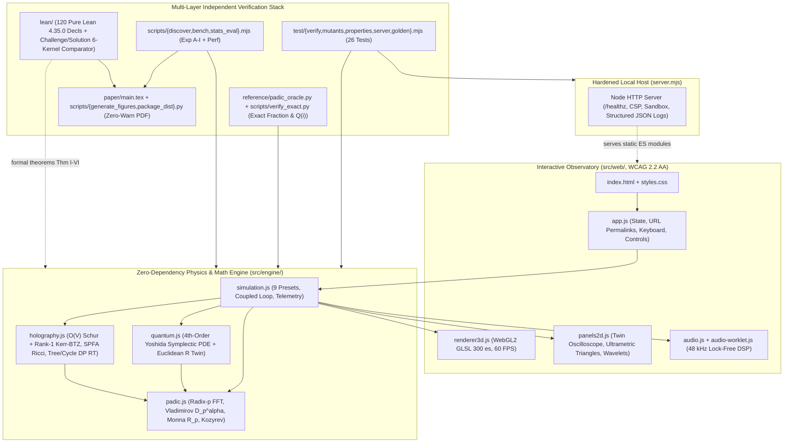

# System Architecture (`docs/architecture.md`)

> Build Standard `A20`. ULTRAMETRICA is engineered as a **zero-dependency**, cleanly layered mathematical-physics engine, real-time WebGL2/AudioWorklet observatory, and pure Lean 4 (`v4.35.0`) formal verification stack.

## 1. High-Level Layered Architecture

---

## 2. Module Responsibilities & Data Flow

### Layer 1 — Pure Mathematical Engine (`src/engine/`)
- **`padic.js` (`PadicSpace`):** Encodes the finite $p$-adic boundary $\mathbb{Z}_p / p^n \mathbb{Z}_p$ ($N = p^n \le 65{,}536$, prime $p \ge 2$, $n \ge 2$). Provides exact little-endian digit extraction, universal base-$p$ Monna digit-reversal involution $R_p$ (`revTable`), ultrametric norm $|x - y|_p$, native $O(p N \log_p N)$ unitary Radix-$p$ Pontryagin FFT (`fftForward`/`fftInverse`), Vladimirov spectrum $|\xi_k|_p^\alpha$, RMS-calibrated Euclidean twin spectrum, and orthonormal Kozyrev wavelets $\psi_{j,b,m}$.
- **`quantum.js` (`PadicQuantumEngine`):** Evolves the nonlinear $p$-adic Gross-Pitaevskii equation $i \partial_t \psi = (D_p^\alpha + g|\psi|^2 + V_{\mathrm{grav}})\psi$ alongside a synchronized Archimedean $\mathbb{R}$ twin using 4th-order Yoshida symplectic operator splitting (3 symmetric Drift-Kick-Drift substeps).
- **`holography.js` (`BruhatTitsBulk`):** Constructs the $(p+1)$-regular cutoff Bruhat-Tits tree $T_p$ (`horizonDepth = 0`) or genus-1 Tate-curve rotating Kerr-BTZ black hole quotient $T_p / p^{h\mathbb{Z}}$ (`horizonDepth >= 1`, $L = p^h \ge 3$, Aharonov-Bohm flux $\Omega \in [-\pi,\pi]$). Solves the gauge-covariant bulk Klein-Gordon equation in exact $O(V)$ time via bottom-up subtree Schur complements + Rank-1 Sherman-Morrison wrap-edge update (Theorem IV), updates dynamic edge lengths $\sigma_e = \ln a_e$ via symmetric Jacobi updates (`_sigmaSnap`), computes exact bipartite SPFA 1-Wasserstein Ollivier-Ricci curvature (Theorems II, V, V-Global), and solves global minimum homologous Ryu-Takayanagi cuts in exact $O(V)$ tree/cycle DP (Theorem VI).
- **`simulation.js` (`UltrametricaSimulation`):** Coordinates 9 curated scientific presets, coupled boundary-bulk feedback, telemetry metrics (ball leakage, norm drift, entropy, curvature extrema, Kerr horizon current), and Adelic hybrid spectrum sweeps.

### Layer 2 — Real-Time Interactive Observatory (`src/web/`) & Host (`server.mjs`)
- **`renderer3d.js`:** Zero-dependency WebGL2 GLSL 300 es renderer with cached uniform locations, ray-picking, `webglcontextlost`/`webglcontextrestored` recovery, and reduced-motion awareness.
- **`panels2d.js`:** Canvas 2D twin oscilloscope, live ultrametric isosceles triangle prover, and interactive Kozyrev wavelet tree.
- **`audio.js` + `audio-worklet.js`:** Lock-free 48 kHz AudioWorklet synthesizing Vladimirov prime-power shells with exponential click-free smoothing and finite-value guards.
- **`server.mjs`:** Hardened local static server enforcing strict `src/` sandboxing, `GET`/`HEAD` allowlist, strict CSP (`default-src 'self'`), fail-fast `PORT` validation (`parsePort`), `/healthz` JSON probe, and structured JSON logging (`LOG_FORMAT=json`).

### Layer 3 — Formal Proofs (`lean/`) & Independent Oracles (`reference/`, `scripts/`)
- **`lean/`:** Zero-Mathlib Lean 4 (`v4.35.0`) formalization split cleanly into statement-only definitions (`UltrametricaProofs/Spec.lean`), four sorry-free proof modules (`Basic`, `AdelicSymmetry`, `HolographyCurvature`, `SolitonAndSolver`), `VerifyAxioms.lean` (120 declarations), and isolated `Challenge.lean` / `Solution.lean` / `comparator.json` audited across 6 independent kernels.
- **`reference/padic_oracle.py` & `scripts/verify_exact.py`:** Completely decoupled Python stdlib implementations verifying exact rational `fractions.Fraction` optimal transport, exact $\mathbb{Q}(i)$ linear solves, exact brute-force RT SSA, and nested-comment-safe Lean audits.
